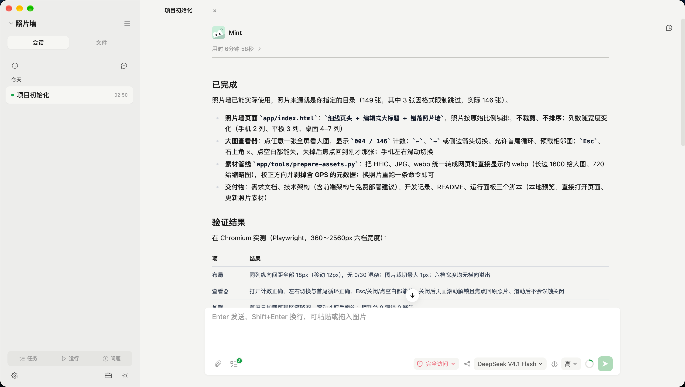
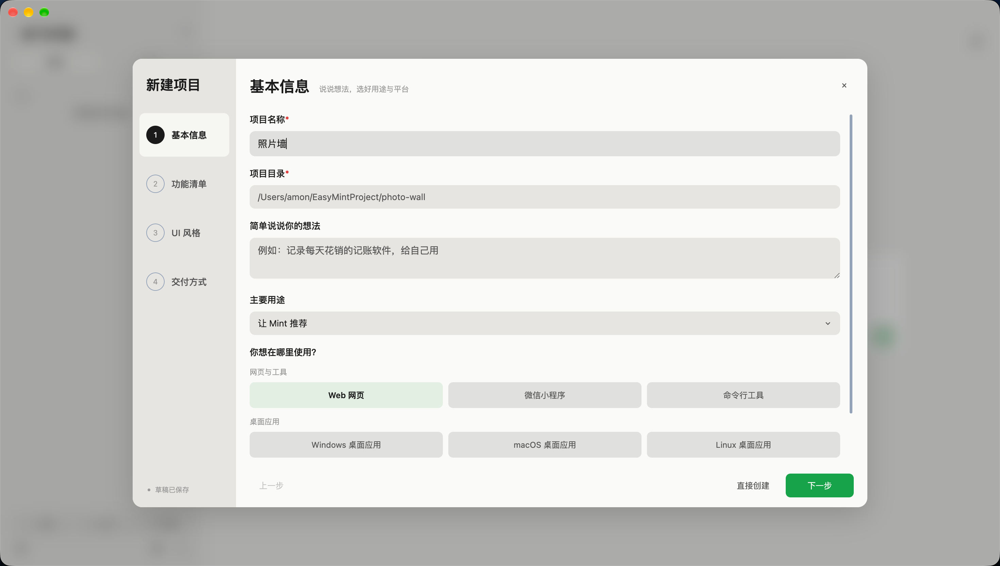
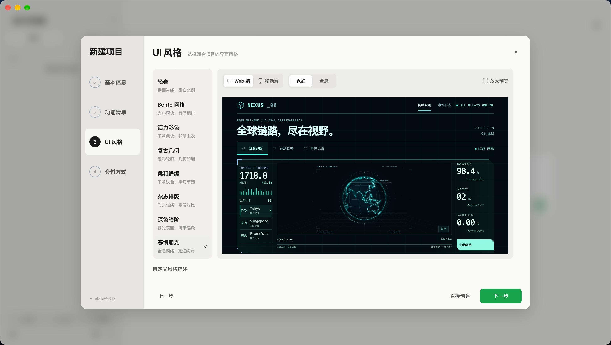
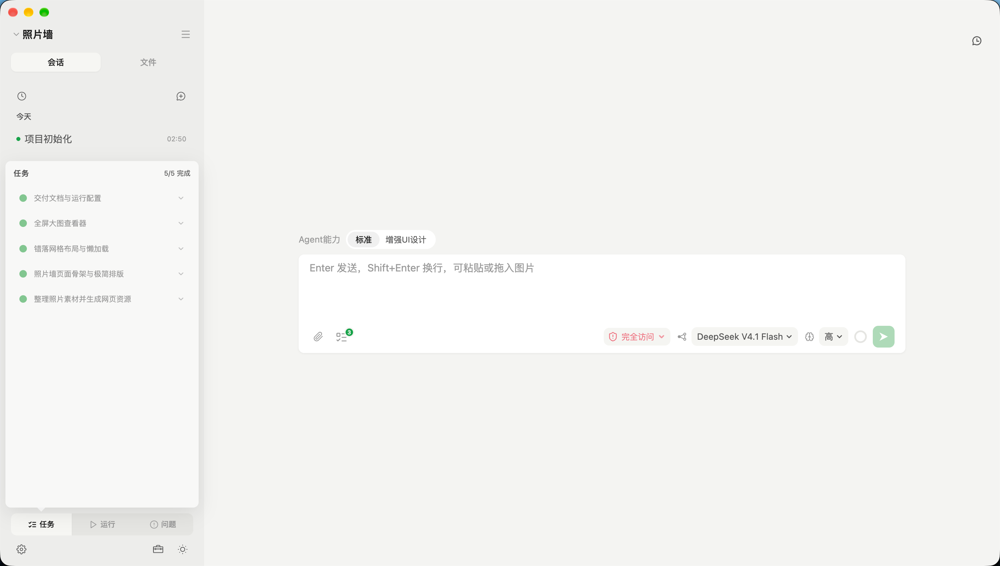
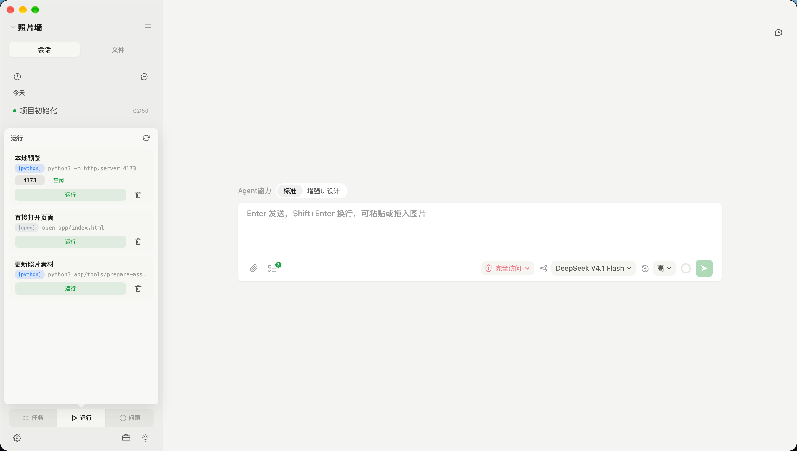
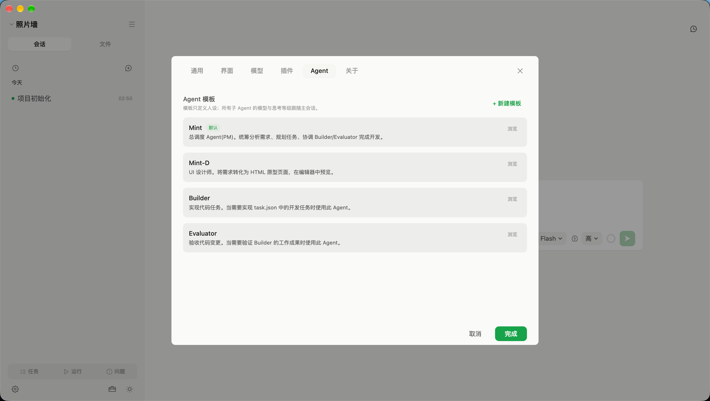
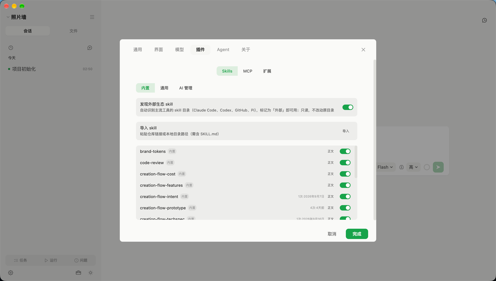
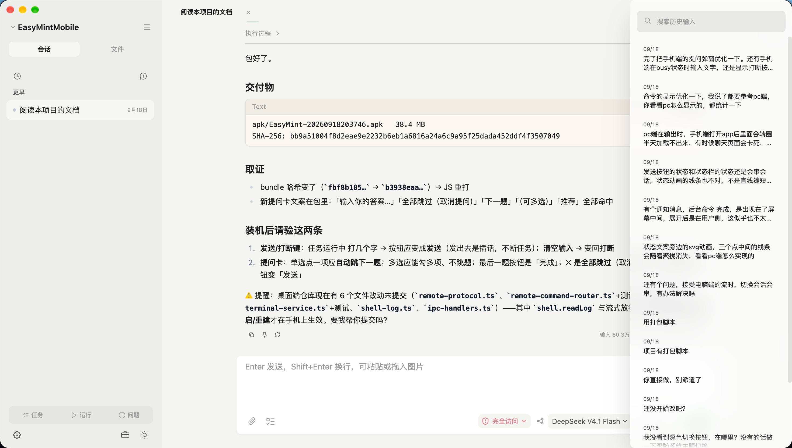
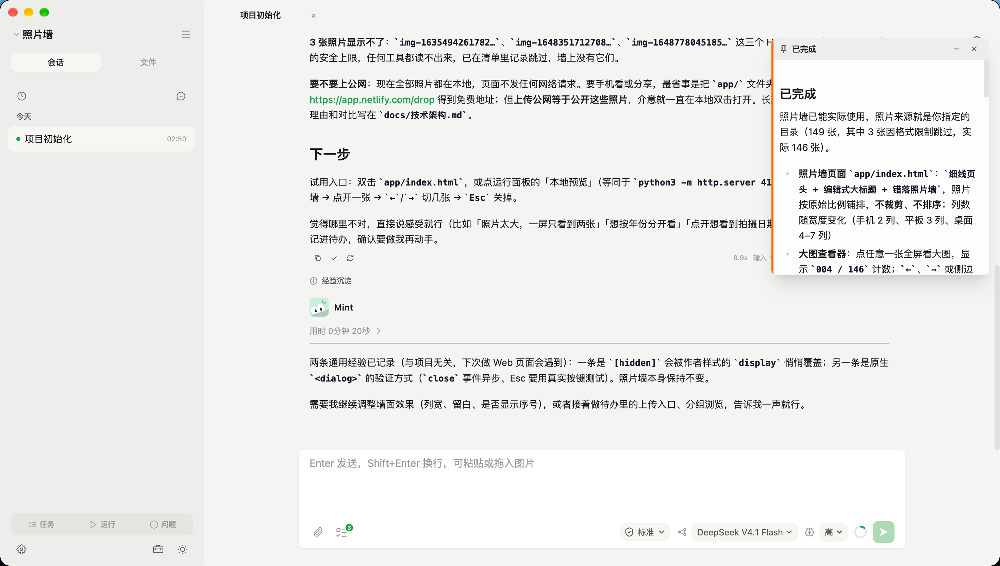

[English](README.en.md)

<p align="center">
  <picture>
    <source media="(prefers-color-scheme: dark)" srcset="assets/appicon-dark.png" />
    
  </picture>
</p>

<h1 align="center">EasyMint</h1>

<p align="center">
  <strong>从想法、原型到交付的开源 AI 编程工作台。</strong>
</p>

<p align="center">
  <a href="https://github.com/tianemon/EasyMint/releases"></a>
  
  
</p>

<p align="center">
  <a href="https://github.com/tianemon/EasyMint">GitHub</a> ·
  <a href="https://gitee.com/tianemon/easymint">Gitee</a>
</p>

---

## 定位

说出你想做什么，与 Mint 一起明确功能，在同一个桌面工作台里推进设计、开发与验收。需要原型的界面项目，可以先选择视觉方向、试用可交互页面，再确认正式实现。

EasyMint 内置 [Pi Coding Agent](https://github.com/earendil-works/pi) 编程引擎，支持 macOS、Windows 和 Linux：新手可以通过项目引导逐步推进，开发者可以把它作为日常的多 Agent 编程工作台。



*在项目会话中先阅读交付结论，需要时展开思考与工具过程。截图暂用中文界面，应用同时支持英文。*

## 设计理念：先让想法成为可以讨论的项目

许多软件的起点并不是一份完整需求，而是一句模糊的判断：某个流程太麻烦，某个工具还缺一块，或者想为自己做一个小产品。真正开始之后，问题才逐渐出现——功能应该怎样拆分，原型、开发与验收是什么关系，又该怎样把要求讲给 AI，才能得到可用的结果。

EasyMint 不假设用户已经掌握这些。四步项目定义把“想做什么”展开为可以逐项选择、逐项修改的约束：基本信息确定范围，功能清单帮助拆分能力，视觉方向把审美偏好变成可比较的页面，交付偏好则明确完成度、部署方式、AI 能力与成本边界。用户不需要先学会编写提示词，也不需要先理解项目结构；先对眼前的选择做出判断即可。

项目开始后，Mint 在实现、解释和复盘之间推进协作。用户会看到需求如何变成任务，任务如何变成原型与代码，哪些约束影响了结果，以及下一轮修改可以怎样表达。EasyMint 的目标不是让人跳过学习，而是让第一个项目能够开始，并在真实协作中逐步建立对软件周期与 AI 沟通方式的理解。

## 快速开始

前往 [GitHub Releases](https://github.com/tianemon/EasyMint/releases) 下载安装包（安装包均超过 Gitee 单附件 100 MB 上限，二进制只从 GitHub Releases 发布；Gitee 仓库为代码镜像）：

| 平台 | 下载格式 |
|---|---|
| macOS · Apple Silicon | `.dmg` |
| Windows · x64 | `.exe` 安装版或便携版 |
| Linux · x64 | `.AppImage`、`.deb` 或 `.tar.gz` |

### macOS 首次打开

安装包没有 Apple 开发者签名、无法公证，所以系统会拦一次：弹窗显示「未打开“EasyMint”——Apple 无法验证“EasyMint”是否包含可能危害 Mac 安全或泄漏隐私的恶意软件」，按钮只有「完成」和「移到废纸篓」。

macOS 15 起右键「打开」不再能绕过，用下面任一种放行（只需一次）。

**方式一：终端命令（最快）**

```bash
sudo xattr -rd com.apple.quarantine /Applications/EasyMint.app
```

输入开机密码（输入时屏幕不显示字符）后回车，再双击即可打开。这条命令只清除这一个 app 的隔离标记，不修改系统安全设置，也不影响其他应用。

**方式二：系统设置里允许**

1. 在拦截弹窗里点「完成」，不要点「移到废纸篓」
2. 打开「系统设置 → 隐私与安全性」
3. 向下滚动到「安全性」区域，会看到「已阻止“EasyMint”以保护 Mac」
4. 点「仍要打开」，输入密码或用 Touch ID 确认
5. 再双击一次 EasyMint，这次弹窗里会出现「打开」按钮，点它

**每次手动下载新安装包都要再放行一次**：新下载的 dmg 会重新带上隔离标记。应用内自动更新不受影响（不经过浏览器，不会带隔离标记）。卸载旧版不会删除项目、会话或设置——它们都在 `~/.easymint/`。

Windows 若出现 SmartScreen 提示，点「更多信息」→「仍要运行」；Linux 的 AppImage 需要先 `chmod +x`。

版本变化与兼容说明见 [更新日志](CHANGELOG.md)。

1. **配置 AI 供应商**：按首次设置引导，使用供应商支持的 API Key 或账号授权。EasyMint 自身无需注册账号，模型调用按供应商规则计费，详见下方「AI 供应商」。
2. **创建或打开项目**：直接对话描述想法、使用四步表单，或导入已有目录。表单依次填写基本信息、功能清单、UI 风格与交付方式。
3. **试用产出**：需要原型的界面项目先打开页面、讨论调整，再确认正式实现；简单任务可以直接推进，引导深度随项目范围调整。
4. **继续开发与迭代**：Mint 亲自实现或委派适合独立完成的工作。查看结果，通过运行面板使用已配置的项目脚本，再提出下一项修改。

静态原型链接**仅供本机访问，在 EasyMint 运行期间有效**，不等同于公开部署地址。需要构建工具或后端的应用使用各自的开发服务。

## 核心特性

- **项目引导与视觉方向**——从对话或四步表单开始，在完整页面中预览网页与移动端风格，也可补充自己的设计描述
- **可交互原型**——先试用页面，再确认实现；静态 HTML 提供可点击的本地预览链接，无需单独配置服务器
- **多 Agent 分工**——Mint 协调需求与任务，Builder、Evaluator、Mint-D 及自定义角色按需承担实现、审查、设计与研究，进度和结果可追踪
- **会话工作台**——多 Tab、多窗口、归档恢复、历史输入检索与悬浮便签；思考和工具过程默认折叠，交付结论保持可读；查看上下文使用率，按需整理长对话
- **任务、待办与运行脚本**——跟进开发任务和 Issue，收集后续想法；运行已配置的项目命令，查看端口状态与彩色日志。运行面板读取项目的 `.easymint/run.json`
- **模型与图像能力**——切换供应商或自定义兼容接口，配置独立视觉模型、生成图片素材，也可通过自动路由搭配规划与执行模型
- **Skills 与工具集成**——复用 Claude Code、Codex、GitHub Agent Skills 生态，连接 MCP 工具；原生 Pi 扩展需明确授权，并用于完全访问会话
- **本地数据与权限控制**——项目文件和会话留在本机，可选只读、标准或完全访问；已配对设备间可通过局域网迁移项目与会话

> 只需要编辑器内代码补全，或偏好不带项目引导的命令行工具时，其他形态可能更轻便。EasyMint 不提供多人共享的云端会话与文档。

## 项目如何开始：四步定义，然后进入协作

四步流程不是一张必须一次填完的问卷，而是把几个容易含糊的决策按依赖关系展开。每一步都提供可比较的选项，也允许补充自己的描述；用户先做选择，Mint 再在会话里继续澄清。

| 步骤 | 用户需要回答的问题 | 转换成的项目约束 |
|---|---|---|
| **Step 1 · 基本信息** | 这是什么项目，在什么场景使用，在哪些平台运行 | 项目名称、用途场景与目标平台 |
| **Step 2 · 功能** | 第一版需要完成哪些事情 | 可讨论、可拆解的功能清单，也可以由 Mint 给出建议 |
| **Step 3 · 视觉方向** | 希望它看起来和用起来是什么感觉 | 通过完整页面比较网页与移动端风格，或写下自己的设计方向 |
| **Step 4 · 交付方式** | 这一版做到什么程度，如何运行，成本边界在哪里 | 完整度、部署方式、AI 能力与预算约束 |

### Step 1–2：把模糊想法变成项目范围

从名称、用途和平台开始，再把“想做的东西”拆成一组具体功能。即使还说不清完整需求，也可以先选择接近的场景，并让 Mint 根据方向推荐功能，再逐项增删。



### Step 3：用页面而不是术语表达视觉偏好

风格选择不是一组抽象标签。每一种方向都以完整页面呈现，可以切换网页与移动端预览，也可以直接描述想要的感觉。用户不必掌握设计术语，也能判断“像不像我想要的东西”。



### Step 4：确认完成度与交付边界

最后一步把“能不能做”落到更具体的约束：这一版是完整版本、MVP 还是演示原型，运行在本地还是云端，是否需要接入 AI 能力，以及更适合充足、有限还是纯免费的技术预算。这些选择不会替代后续讨论，但能让第一次实现有明确的范围与取舍。

### 创建之后：从任务、原型到可运行项目

完成四步确认后，Mint 会把项目范围转成后续任务。界面项目可以先通过本地链接试用原型，再确认实现；开发过程中，任务进度与运行脚本始终在会话旁边。反复使用的命令可以收进运行面板，启动、停止与日志查看都不需要离开工作台。

| 任务进度 | 运行脚本 |
|---|---|
|  |  |

<details>
<summary>更多工作台工具：Agent 模板、Skills、历史输入与内容便签</summary>

在设置中选择 Agent 职责，复用已有 Skills 与 MCP 集成；对话过程中，可以查找之前的输入，也可以把重要输出钉成悬浮便签。

| Agent 模板 | Skills 与工具集成 |
|---|---|
|  |  |

| 历史输入 | 内容便签 |
|---|---|
|  |  |

</details>

## 本地数据与权限

EasyMint 自身**没有账号系统、遥测或项目云存储**。AI 请求由本机直连你配置的供应商，消息、Agent 读取的文件、命令输出与图片可能进入请求，供应商的隐私和数据保留政策随之适用。完整说明见中英双语的 [隐私与数据处理](PRIVACY.md)。

默认本地存储分为：

| 位置 | 内容 |
|---|---|
| 你的项目目录 | 源码、文档与生成的素材 |
| `<project>/.easymint/` | 项目配置、待办与项目级经验 |
| `~/.easymint/` | 应用设置、供应商凭据、会话、技能与项目运行区 |

供应商凭据以明文保存在本机；MCP OAuth 凭据优先使用系统安全存储，Linux 缺少可用钥匙串时会回退为明文。请妥善保管全局数据目录。

| 权限档位 | 适用操作 | 边界 |
|---|---|---|
| 只读 | 查看项目内容 | 仅允许已批准的读取工具，不执行命令、不写入、不联网 |
| 标准 · 默认 | 开发与运行检查 | 系统沙盒、独立项目运行区与网络白名单，按规则提供兼容豁免 |
| 完全访问 | 使用真实环境及本机登录态 | 不套系统沙盒，执行前检查提供尽力保护 |

<details>
<summary>权限执行、兼容豁免与 Pi 扩展边界</summary>

EasyMint 在**执行前判定**操作权限，标准档的命令同时运行在系统沙盒内。检查涉及以下三类边界：

Pi 扩展是用户明确授权的主进程代码，仅在**完全访问模式**的会话中加载。扩展初始化与事件处理不经过普通工具的内核沙盒；切回标准或只读后，当前回答可完成，扩展工具立即停用，会话在空闲时关闭并按新权限重建。

- **系统核心**——系统目录、原始设备，以及磁盘与安全机制本身（`csrutil`、`spctl`、`fdesetup` 等）：三档都拒绝
- **危险操作**——提权（`sudo` / `doas`）、系统服务变更，以及**会自动执行代码的持久化配置**（MCP 配置、开机自启目录、EasyMint 的模型与供应商设置）：三档都拒绝
- **普通资源**——只读档仅允许读取批准范围内的普通项目内容；标准档限定可写位置，并保护高敏凭据；完全访问放开普通工作区限制

三档的差别在**环境与强制方式**，不在能不能干活：

- **只读模式**——**普通项目内容读自由（敏感凭据除外），其余一律拒绝**：纯读工具采用白名单，未知工具默认拒绝；不执行命令、不写入文件或应用状态、不启用 MCP、不联网，SSH 私钥、云凭据和浏览器登录数据也不可读。代价是不能构建 / 测试 / 装依赖，**git 操作也不行**——它面向"只看不动"，不是日常开发档
- **标准模式（默认）**——两层一起生效。**环境隔离**：`HOME`、`TMPDIR`、npm / pip / cargo 等缓存全部重定向到 `~/.easymint/runtimes/<项目标识>/`，不同项目使用各自的运行区，运行区独立存放于全局数据目录。**内核边界**：命令跑在系统级沙盒里（macOS Seatbelt / Linux bubblewrap / Windows 独立沙盒账户），越界写入与凭据读取由内核拦下。配套三件事让它不误伤：① **兼容性清单**；② **单命令兼容豁免**（`open` 只接受单个 HTTP(S) URL；复合命令、管道、重定向和命令替换不豁免）；③ **网络白名单**。`gh`、`gcloud` 等可能需要完全访问；**`git push` / `fetch` 可以直接用**（走 ssh-agent 签名，前提是 key 已在 agent 里）。
- **完全访问**——用你的真实环境执行、**不套沙盒**：`gh`、`git push`、系统命令、打开浏览器与浏览器自动化（Playwright）都能用；切换前有一次性风险确认。系统核心、提权与持久化配置只由执行前判定尽力拦截，动态脚本没有强隔离保证
- **判定口径克制**——判定层只对确定目标的路径做提前判定，并拦截提权类命令；命令中的消息文本、正则与脚本内容不会被当成路径误判。它现在是**兜底**而非主防线：更早、更可读的拒绝理由由它给出，真正的强制在内核那层
- **状态一眼可见**——输入卡的盾形图标与配色随权限档位切换：只读（盾内锁）、标准（盾内勾）、完全访问（盾内感叹号 + 危险色）

</details>

## 工作台详细说明

<details>
<summary>Agent 分工与模板、项目工具、经验沉淀和 Skills</summary>

### 多 Agent 协作

- **Mint（项目经理）**——需求理解、按需规划任务、Agent 调度与进度把控
- **Builder（编码）**——按任务实现代码、运行测试、修复问题，支持 TDD
- **Evaluator（验收）**——对照需求检查产出，不合格退回重做
- **Mint-D（UI 设计）**——产出 HTML 原型，内置品牌库与设计规范
- **子 Agent（通用委派）**——探索、审查、实现等类型化委派，回传摘要不占主上下文

任务进度在面板实时展示；角色任务指定对应模板，通用任务使用标准子 Agent，委派深度与类型受控。

### Agent 模板

Mint、Mint-D、Builder 和 Evaluator 四个内置模板均为**只读**。需要定制时，新建模板填写名称、职责描述与提示词。子 Agent 的供应商、模型和思考级别跟随主会话，不在模板中单独配置。

### 项目管理

- 文件树 + Monaco 编辑器（语法高亮、智能提示）
- 多 Tab 会话、多窗口
- 项目重命名（会话数据自动迁移）/ 重新定位 / 导入已有目录
- Git 集成
- 跨设备项目迁移（文件与会话）

### 内容便签

AI 输出的重要内容可钉成悬浮便签固定在聊天区：一键钉住、可调大小、吸附成彩色贴纸、随会话持久化。

### 经验沉淀

Mint 可以把「这次踩的坑与解法」沉淀成经验，供后续项目复用（默认关闭，可在设置中开启）：

- **两级作用域**——全局经验（本机环境、协作方式）与项目经验分开存放，项目经验随项目走
- **只注入索引**——上下文里只放标题、标签与计数，正文按需读取，不挤占对话空间
- **按技术栈投递**——带技术栈或平台标签的经验只在匹配的项目里出现（Flutter 的经验不会跑进 React 项目）
- **可读可改可删**——经验就是 markdown 文件，沉淀时直接入库、无需确认，随时可改可删

### Skill 生态

EasyMint 与主流 AI 编程工具的 skill 生态互通，已有的技能资产开箱即用：

- **自动发现**：Claude Code（`~/.claude/skills/`）、Codex（`~/.codex/skills/`）与 GitHub Agent Skills（项目 `.github/skills/`）目录下的标准 skill 自动出现在技能列表，只读发现、不改动原目录
- **项目级优先**：项目内 `.claude/skills/`、`.codex/skills/`、`.github/skills/` 下的 skill 自动可用，与全局同名时以项目内的为准（界面标注来源与被遮蔽状态）
- **粘贴即装**：把 GitHub 仓库链接或本地 skill 目录发给 Mint 即可安装到技能库（只拷贝文件，不执行仓库内脚本）
- **AI 管理区**：设置中开启「允许 AI 创建与管理 skill」后，Mint 可在会话中创建、更新、删除自有 skill，与手写 skill 物理隔离

</details>

## AI 供应商

内置 **Anthropic、OpenAI、OpenAI Codex、GitHub Copilot、OpenRouter、DeepSeek、智谱 GLM（Z.AI）、Kimi、MiniMax、Qwen、小米 MiMo、xAI、Google Gemini、OpenCode** 等主流平台预设，选中即可用；也支持自定义供应商（OpenAI / Anthropic 兼容协议）；可同时配置多个供应商并随时切换；**视觉模型独立配置**（图片理解、界面验证等场景可选专用模型）。

两种接入方式，按供应商二选一（部分供应商两种都支持，可在设置里切换）：

- **账号登录（浏览器授权）**——不用自备 API Key，在应用内点登录、浏览器里完成授权即可：**Anthropic**（订阅用量按 token 计费，不占套餐额度）、**OpenAI Codex**（用 ChatGPT Plus / Pro 订阅账号登录）、**GitHub Copilot**（订阅账号）、**OpenRouter**、**Kimi Coding**、**xAI**
- **API Key**——其余内置供应商（**OpenAI**、DeepSeek、智谱 GLM / Z.AI、MiniMax、Qwen、Google Gemini、小米 MiMo、OpenCode 等）与自定义供应商；密钥与账号凭据一样只存在本机，**以明文存放于 `~/.easymint/`**（与 `.npmrc`、`git-credentials`、`~/.aws/credentials` 同类做法；MCP OAuth 凭据优先使用系统安全存储，回退行为见隐私说明）——详见 [PRIVACY.md](PRIVACY.md)

> 某家供应商支持哪种接入方式，由内置引擎的能力声明决定——设置页的「认证方式」分段只在**两种都支持**的供应商上出现，只支持一种的不会给你一个填了也没用的输入框。**注意「OpenAI」与「OpenAI Codex」是两个独立预设**：前者是 OpenAI 官方 API（`api.openai.com`），只能填密钥；后者的接口对应 Codex 订阅（`chatgpt.com/backend-api`），只能账号登录。选哪个预设，决定你能用哪种方式接入。

## 联网搜索

Mint 内置的联网搜索与网页正文提取由 [Tavily](https://tavily.com) 提供。在 [app.tavily.com/home](https://app.tavily.com/home) 创建 API Key，填入「设置 → 模型 → 模型能力增强 → 联网能力」；搜索与抓取共用一个 Key，首次设置配置的也是同一处。

内置工具使用 basic 搜索与提取。免费额度和计费由 Tavily 决定，参见[官方积分与价格说明](https://docs.tavily.com/documentation/api-credits)。提取失败时，EasyMint 可能改为从本机直接访问目标网址，详见 [PRIVACY.md](PRIVACY.md)。

清空 Key 会停用 EasyMint 内置的搜索与抓取工具，没有独立开关。已配置的 MCP 工具或 Agent 执行的命令可能具有各自的联网能力与权限要求。

## 视觉识别

纯文本模型不具备识图能力时，可配置独立的视觉模型（OpenAI 或 Anthropic 兼容接口），使 AI 具备读取图片、核对界面截图的能力。**填写 Key 即启用，清空即停用**（没有单独的开关）。

## 原生图像与自动模型

在「设置 → 模型 → 原生图像与自动模型」选择已配置供应商的图像模型，新建或重新打开会话后，即可让 Mint 生成或参考已有图片编辑素材。图片保存到项目内已有目录，聊天中的文件链接可打开预览；调用使用供应商凭据并产生图像 API 费用。

配置规划与执行模型后，可在规划供应商的模型列表选择 `easymint-auto`。每条新消息先使用规划模型，成功编辑文件后切到执行模型，重试保持原模型；回复显示实际调用模型。自动路由正在运行时，等本轮结束再修改配置。模型切换可能失去缓存或触发上下文整理，费用收益需结合实际任务评估。

## 手机端（Android / iOS）

EasyMint 支持**在同一局域网内用手机连接并控制桌面端**——手机与电脑扫码配对后，即可远程操作电脑上当前打开的项目和会话：发消息、看模型的思考与工具调用过程、回答提问、查看后台任务与子 Agent 进度，也可以把图片和文档随消息一起发过去。适合离开座位时继续盯着任务、或者躺在沙发上给 AI 补一句。

手机客户端仓库：[**tianemon/EasyMintMobile**](https://github.com/tianemon/EasyMintMobile)

- **安装**：到 [EasyMintMobile 的 Releases](https://github.com/tianemon/EasyMintMobile/releases) 下载 Android APK 安装（iOS 需要自行签名，该仓库里带本地打包脚本）
- **配对**：电脑端侧边栏底部的「工具箱」→「连接手机」生成二维码 → 手机扫码并核对六位数字 → 在电脑上确认

手机端只保存配对凭证，项目、会话与消息都留在电脑侧；两端通过 P-256 ECDH + AES-256-GCM 加密通道通信，电脑不会把项目绝对路径或 API 密钥发给手机。

## 界面语言

首次设置的欢迎页或「设置 → 通用 → 界面语言」可选择简体中文、English 或跟随系统。默认跟随系统：简体或繁体中文系统均显示简体中文，其他系统显示英文。已手动选择的界面语言会保留。

应用自有界面支持中英文，包括设置、项目创建与管理、聊天操作、权限与错误提示、环境检测、设备迁移和 HTML 原型编辑器。手动切换语言无需重启，并同步到其他应用窗口。

语言切换不改写历史聊天、用户名称、项目文件、内置提示词或原型模板内容；AI 回复继续跟随用户语言。第三方工具输出和原始诊断保留原文，系统自带控件遵循平台语言。

## 技术栈

| 层 | 技术 |
|----|------|
| 桌面框架 | Electron 43 |
| 前端 | React 19 + Vite + TypeScript 6 |
| UI | Tailwind CSS 4 + 自研组件 |
| 状态管理 | Zustand 5 |
| 代码编辑器 / 终端 | Monaco Editor / xterm.js |
| 插件生态 | Pi Extensions / Model Context Protocol SDK |
| AI 引擎 | Pi Coding Agent 1.4.0 |

## 本地开发

```bash
git clone https://gitee.com/tianemon/easymint.git   # 国内镜像
# 或 GitHub 主仓库：git clone https://github.com/tianemon/EasyMint.git
cd easymint
node scripts/install-deps.cjs
npm run dev          # Vite dev server + Electron
npm run build        # 生产构建
npm run lint         # ESLint + TypeScript 类型检查
```

需要 Node.js 环境。安装脚本通过 `ELECTRON_MIRROR` 配置 Electron 下载镜像；已有环境变量会保留。锁文件安装可使用 `node scripts/install-deps.cjs ci`。

## 开发纪事

EasyMint 的开发本身就是一次「AI 编程」实践：项目约 99% 由 DeepSeek 模型完成（7 月起为最便宜的 flash 档），从 14 个文件的 shell 模板长成如今的桌面产品。

[**用最便宜的模型，做出专业级的桌面编程 Agent**](PROJECT_STORY.md)
